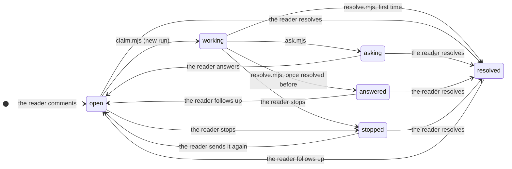

# The comments file and the step files

Code Buddy keeps two kinds of files for a project:

| File | Where | Holds | Written by |
| --- | --- | --- | --- |
| `comments.json` | In the project, at `commentsFile` of `.code-buddy.json` (`.code-buddy/comments.json` by default; `CODE_BUDDY_COMMENTS_FILE` overrides it) | The discussions: every comment, its thread, its state and the history of its moves | The store (`scripts/lib/store.mjs`), for the server and the agents' scripts |
| `<id>.jsonl` | In the state folder, `<state>/<hash>/progress/` | The steps of the run in progress on comment `<id>` | The hooks (`hooks/register.ts`) |
| `<id>.history.jsonl` | Next to it | The steps of every run that ended, with a dev build of the widget only | The store, when a run ends |
| `images/<id>/m<n>-<k>.<ext>` | Beside `comments.json` | The images the reader attached to message `m<n>` of comment `<id>` | The store, from the widget's request |

`<state>` is `CODE_BUDDY_STATE_DIR`, else `$XDG_CACHE_HOME/code-buddy`, else
`~/.cache/code-buddy`. `<hash>` is the first 12 hex digits of the SHA-1 of the
project's root: each project has its own folder. Deleting a comment deletes
its step files and its images; `comments.json` never holds a step nor an
image's bytes.

The reference for the comments file is
[`skills/code-buddy/scripts/lib/format.mjs`](../skills/code-buddy/scripts/lib/format.mjs):
its version, states, moves and JSDoc types. The widget mirrors them in
`skills/code-buddy/widget/src/domain.ts`.

## `comments.json`

### The envelope

```jsonc
{ "version": 2, "comments": [ /* Comment, oldest first */ ] }
```

Any other `version`, or a bare array (version 1), is refused and left
untouched: the server stops with `COMMENTS_REFUSED old comments format: delete
<file>`, and the scripts print the same message.

### A comment

```jsonc
{
  "id": "b96fae58-5cc3-426b-9632-77f3a7f8f866",
  "route": "/",                              // "*": about the whole app
  "url": "http://localhost:5190/",           // the page and its query, no hash
  "anchor": {
    "section": "Coffee roasted the week you drink it", // the heading above it
    "quote": "",                             // the selected text; "" when none
    "occurrence": 0,                         // which occurrence of the quote
    "element": {                             // when the reader pointed at one
      "selector": "#root > main > section:nth-of-type(1) > h1",
      "tag": "h1",
      "text": "Coffee roasted the week you drink it",
      "html": "<h1>Coffee roasted the week you drink it</h1>"
    }
  },
  "state": "resolved",                       // always the last event's
  "createdAt": "2026-10-10T15:44:37.597Z",   // equals messages[0].at
  "messages": [ /* Message */ ],
  "events": [ /* Event */ ],
  "cancellation": { /* the last stopped run, when there is one */ }
}
```

| Field | Type | Notes |
| --- | --- | --- |
| `id` | string | A UUID. |
| `route` | string | The page's path, or `*` for the whole app. |
| `url` | string, optional | An `http` or `https` URL, up to 2000 characters, without credentials or hash; the server drops any other, and replaces the values of its secret-looking parameters (`token`, `code`, `session`…), in the query or the path (`;jsessionid=…`), with `redacted`. |
| `anchor.section` | string | Up to 300 characters. |
| `anchor.quote` | string | Whitespace-collapsed, up to 2000 characters. |
| `anchor.occurrence` | integer ≥ 0 | |
| `anchor.element` | object, optional | `selector` (500), `tag` (20), `text` (200) and `html` (600), truncated. The server leaves out of `html` the `value` and `content` attributes and the secret-looking ones (`nonce`, `data-token`…), and redacts the secret-looking parameters of its links (`href`, `src`, `srcset`, `data-*`…). |
| `state` | State | See [States](#states-and-moves). |
| `createdAt` | ISO date | Lists sort by it. |
| `messages` | Message[] | The whole thread, the reader's comment first. |
| `events` | Event[] | Every move, oldest first, never overwritten. |
| `cancellation` | Cancellation, optional | Kept after a re-send, so the next agent sees it. |

### A message

```jsonc
{ "id": "m1", "author": "reader", "body": "change le titre", "at": "…" }
{ "id": "m2", "run": "r1", "author": "claude", "question": true,
  "body": "Quel nouveau titre veux-tu ?",
  "options": [{ "label": "Café torréfié la semaine où tu le bois", "description": "traduction en français" }],
  "at": "…" }
{ "id": "m3", "author": "reader", "body": "Café torréfié la semaine où tu le bois",
  "choices": ["Café torréfié la semaine où tu le bois"], "at": "…" }
{ "id": "m4", "run": "r2", "author": "claude", "body": "Le titre est changé.", "at": "…" }
```

| Field | Type | Notes |
| --- | --- | --- |
| `id` | `m1`, `m2`… | In sequence within the comment. |
| `author` | `reader` or `claude` | |
| `body` | string | |
| `at` | ISO date | |
| `run` | `r1`, `r2`…, Claude only | The run that wrote it. |
| `question` | `true`, Claude only | A question rather than an answer. |
| `options` | `{ label, description? }[]`, a question only | 2 to 6, distinct labels; the reader may answer in their own words instead. |
| `multiple` | `true`, with `options` | The reader may pick several. |
| `choices` | string[], reader only | The options they picked, also written at the start of `body`. |
| `images` | string[], reader only | The images they attached, file names in `images/<id>/` (see [Images](#images)). |
| `elements` | PickedElement[], reader only | The elements they picked in the page with it, up to 5: an element's `selector`, `tag`, `text` and `html`, cut and redacted as `anchor.element`'s, and `route`, the page it was on, which may be another than the comment's. |

### An event

```jsonc
{ "at": "2026-10-10T15:44:57.469Z", "state": "working", "by": "agent", "run": "r1", "agent": "a3fbb6e8bc0e856d1",
  "model": "claude-haiku-5-5", "complexity": "trivial" }
```

| Field | Type | Notes |
| --- | --- | --- |
| `at` | ISO date | |
| `state` | State | The state the comment moved to. |
| `by` | `reader`, `agent` (`server` is reserved) | Who moved it. |
| `run` | `r1`, `r2`…, optional | The run it belongs to. Each `working` event starts one. |
| `agent` | string, optional, `working` only | The Claude Code agent that claimed it (`main` for a session's main loop), which the hooks pass to `claim.mjs`. |
| `model` | string, optional, `working` only | The model its agent runs on, as Claude Code resolved it when the hooks started it (`claude-haiku-5-5`); the widget names its family (`haiku`). |
| `complexity` | `trivial`, `standard` or `hard`, optional, `working` only | How the hooks' classifier sorted the comment, which picked `model` through `.code-buddy.json`'s `models` (see [Models](#models)). Absent when the classifier did not run or failed. |

### A cancellation

```jsonc
{ "at": "2026-10-10T15:52:19.733Z", "changed": ["src/data.ts"], "steps": 2, "run": "r6" }
```

`at` is the time of its `stopped` event. `changed` lists the files the stopped
run had written, relative to the repository: a failed write is not counted,
and one cut short by the stop is. `steps` counts its tool calls, not its
thinking or messages.

### States and moves

| State | Means |
| --- | --- |
| `open` | Waiting for an agent. |
| `working` | An agent claimed it: a run is in progress. |
| `asking` | Claude asked the reader a question. |
| `answered` | Claude answered a follow-up on a thread resolved before: the reader follows up again or resolves it. |
| `stopped` | The reader stopped the run. |
| `resolved` | Done. |



| Move | Trigger | `by` | Also writes |
| --- | --- | --- | --- |
| `open → working` | `claim.mjs` | agent | A new `run` in the event. Claimed again while working, it stays in its run. It prints its `claimed` line, then the comment for its agent as JSON: `route`, `url`, `anchor`, `state`, `messages` (the reader's comment and the 19 latest, `elided` saying how many it left out, their `images` as absolute paths) and `cancellation`; `url`, `elided` and `cancellation` only when set. |
| `working → asking` | `ask.mjs` | agent | A `claude` message with `question` and `run`. |
| `working → resolved` | `resolve.mjs`, on a thread never resolved | agent | A `claude` message with `run`. |
| `working → answered` | `resolve.mjs`, on a thread resolved before | agent | A `claude` message with `run`. |
| `open` or `working → stopped` | PATCH `cancelled: true` | reader | The `cancellation`, with the `run`. |
| `asking`, `answered` or `resolved → open` | PATCH `followUp`, `choices`, `images` and/or `elements` | reader | A `reader` message. |
| `stopped → open` | PATCH `cancelled: false`, or a `followUp` | reader | With `text`, the last `reader` message's new words, its `choices` dropped; empty, its images or elements alone when it has some. |
| `open`, `asking`, `answered` or `stopped → resolved` | PATCH `status: "resolved"` | reader | Nothing else. |

The store refuses any other move, and writes nothing: the server answers 409
with the reason (`comment <id> is resolved`), which the widget shows. Two
exceptions, as a click a poll late or twice is no error: a stop on a comment
no longer `open` or `working`, and a re-send of one no longer `stopped`,
change nothing. `ask.mjs` and `resolve.mjs` on a comment still `open` claim it
first (`open → working`).

The page marks a comment's anchor (an element's outline, a text's rainbow)
until its thread is first resolved: a follow-up does not bring it back. The
elements picked in a message are not marked: their chip in the thread outlines
one while it is hovered, and scrolls to it and flashes it once clicked.

### Elements picked in a message

The reader may pick elements in the page for any message, the comment or a
reply (the composer's pointer button; the widget's _Point at element_ starts
a comment with one): they go with the message, up to 5, as `elements` (see
[A message](#a-message)), alone or with words, images or choices; the server
drops one with no `route`. The widget no longer writes `anchor.element`, which
older comments keep. The `NEW` line for the hooks names them after the
comment's `body`, the `FOLLOWUP` and `EDIT` lines after the reply's `choices`:
` elements=["<button> Buy","<a> Help on /help"]`, the page added when it is
not the comment's. The agent reads them whole in the thread `claim.mjs`
prints.

### Models

Before the plugin's hooks start a comment's agent, they read the comment (the reader's last message,
the selected text, the element's tag and text and those of the elements picked
with the message, the route) and asks Claude
Code's small fast model for one label:

| Label | For |
| --- | --- |
| `trivial` | Copy, spacing, colour, a visible property of one element. |
| `standard` | A component's behaviour, a new element, a small feature. |
| `hard` | Anything across several components or pages, data or API changes, or a question that needs a product decision. |

`models` in `.code-buddy.json` maps each label to a model alias (`haiku`,
`sonnet`, `opus`) or id; `inherit` keeps the session's model. Without
it, the default is:

```json
"models": { "trivial": "haiku", "standard": "inherit", "hard": "opus" }
```

A `models` object is read whole: a label it leaves out inherits, so
`{ "trivial": "inherit" }` turns routing off, and the classifier is not
asked. A classifier that fails or takes more than 5 seconds leaves the agent
on the session's model. A comment of images alone, which the classifier
cannot read, is not classified, routing on or off: its agent starts on the
session's model at a `medium` effort, with no label. In every case the hooks
write the agent, the model it runs on and the label in the state folder
(`routes/<id>.json`, beside `progress/`), and `claim.mjs` records them on the
`working` event (`CODE_BUDDY_AGENT`, `CODE_BUDDY_MODEL` and
`CODE_BUDDY_COMPLEXITY` override them). A follow-up resumes the same agent,
with no new start: it keeps its model and its effort.

## The step files

One JSON object per line. A tool writes one line when it starts and one when
it ends or fails, with the same `id`: readers merge them into one step, in the
place where it started. The agent's thinking and messages have no `id` and
one line each.

```jsonc
{"at":1791647537691,"id":"toolu_01Mk9U…","kind":"read","label":"src/data.ts","state":"running","run":"r6"}
{"at":1791647537702,"id":"toolu_01Mk9U…","kind":"read","label":"src/data.ts","state":"done","run":"r6"}
{"at":1791647539037,"kind":"thinking","label":"","run":"r6"}
```

| Field | Type | Notes |
| --- | --- | --- |
| `at` | number | Milliseconds since the epoch. |
| `kind` | string | `start` (the claim), `read`, `edit`, `write`, `multiedit`, `bash`, `search`, `web`, `mcp`, `skill`, `tool` (any other tool), `thinking`, `message`. |
| `label` | string | The file, from the project; the command's description; the pattern, the host, `server · tool`… Empty for thinking the API redacted. Up to 400 characters for thinking and messages. |
| `id` | string, tools only | Claude Code's `tool_use_id`: the debug panel finds the call in the transcripts with it. |
| `state` | `running`, `done` or `failed`, tools only | |
| `error` | string, optional | Why it failed: the first line of the tool's error, or the hooks' reason (a lock held by another comment's agent, a write from Bash). |
| `run` | `r1`, `r2`… | The run it belongs to: the hooks write it from `claim.mjs`'s output, and the store adds it to untagged steps when it archives them. |
| `agent` | string | The Claude Code agent that called the tool (`main` for a session's main loop). Runs of one comment may have different agents. |
| `model`, `complexity` | `start` only, optional | As on the `working` event: the widget reads "Started on haiku". |

`<id>.jsonl` exists only while a run is in progress. When the run ends
(`ask.mjs`, `resolve.mjs`, a stop, the reader resolving), the store moves its
lines to `<id>.history.jsonl` with a dev build of the widget, or drops them,
and the hooks add the ending script's own step, done, to the history.

The server never writes steps into `comments.json`. It serves them with the
comments: `progress`, the last 10 steps of the run in progress, and with
`history=1` (the debug panel), `history`, every step of every run. With a dev
widget, `GET /api/debug/steps/<id>` serves both files as they are on disk,
history first, which the debug panel opens in a tab.

## Images

The reader pastes or drops an image in the widget's message box: it goes with
the message, a new comment (`POST /api/comments`) or a reply (`PATCH` with
`followUp` or `choices`, or alone), as `images`: `{ type, data }` objects,
`data` in base64. An image alone is a message, with an empty `body`. The
server takes up to 4 per message, PNG, JPEG, GIF or WebP, up to 5 MB each, and
checks the bytes, not only the type; it refuses any other image with 422 and
its reason, which the widget shows. These limits live in
`scripts/lib/image-limits.json`, which the widget bundles to refuse an image
before sending it. A request may then hold up to 100,000 characters of text
besides its images. Images sent with only another move (`status`, `cancelled`)
are ignored. The server refuses any change (403) from a page whose origin it
does not let in: a page of another site could send one without reading the
answer.

The store writes them beside the comments file, as
`images/<comment id>/m<n>-<k>.<ext>` (`m1-1.png`: the first image of the
comment), and lists their names on the message. The server serves them at
`GET /api/images/<comment id>/<name>`, for the thread's bubbles, and adds their
full paths to the comment's line for the hooks (`NEW`, `OPEN`, `FOLLOWUP`,
`EDIT`): ` images=["/…/.code-buddy/images/<id>/m1-1.png"]`, at the end of the
line, for the images of the message it carries. The agent opens them with
Read. Deleting the comment deletes its folder.

## What the server adds

On an open comment, the server also serves `notifiedAt`, an ISO date: when it
printed that opening's line (`OPEN`, `NEW` or `FOLLOWUP`) for the plugin's hooks. It
lives in the server's memory, never in `comments.json`: a restart prints the
line again and dates it anew. The widget reads "Sent…" until then, "Claude
has your comment, an agent is starting…" once it is, "Claude has your
comment, waiting for a free agent…" when no agent has claimed the comment 15
seconds later, and "No agent has started. Check the Claude Code session
watching." after 60 seconds. On the reader's reply (an answer or a follow-up:
`FOLLOWUP`), the widget reads "Claude has your reply, an agent is picking it
up…", "Claude has your reply, waiting for a free agent…" and "No agent has
picked up your reply. Check the Claude Code session watching." Each return to `open` (an answer, a follow-up, a re-send)
starts again.

With `history=1` (the debug panel), every comment the server printed a line
about since it started also has `lines`: `{ at, line }` objects, oldest first,
each line as printed (the last 50). They live in its memory too, and go when
the comment is deleted. The debug panel marks the `OPEN`, `NEW` and
`FOLLOWUP` lines as hand-overs, dated from their opening, and dates each claim
from the hand-over of its opening. With a dev widget, `GET /api/debug/agent/<agent>`
serves what the agent of a `working` event was given: its first message,
exactly the prompt the hooks wrote, read in Claude Code's transcripts of
the last 7 days, and its type (`agentType`, from the `.meta.json` next to the
transcript); for one of the plugin's agents, its instructions
(`instructions`, `agents/<name>.md`), read as it is now: Claude Code does not
keep it.
